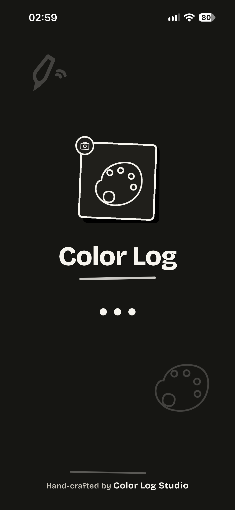
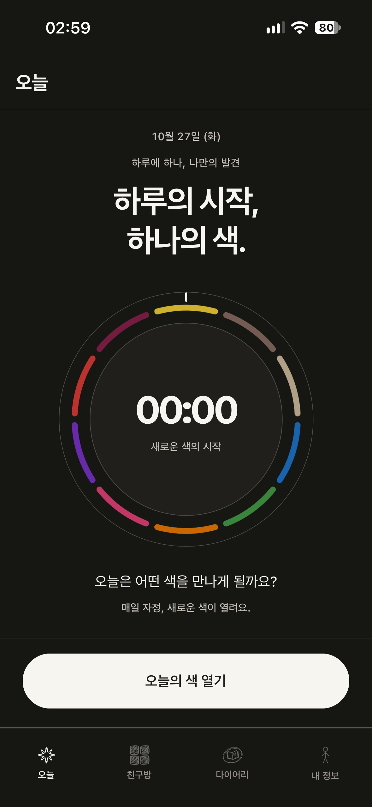
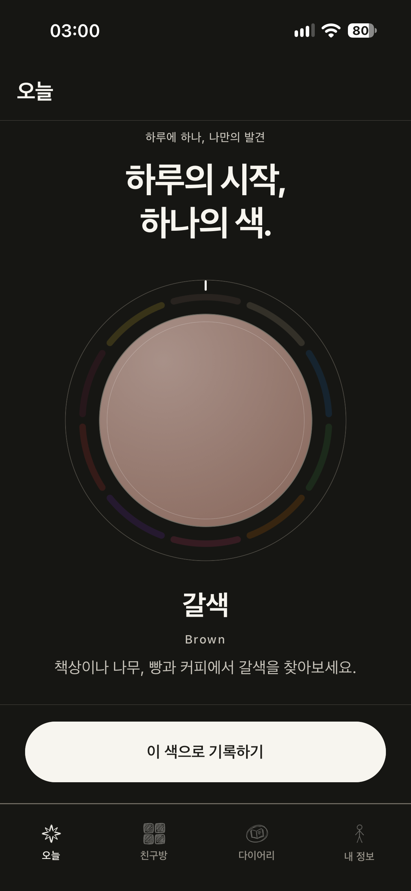
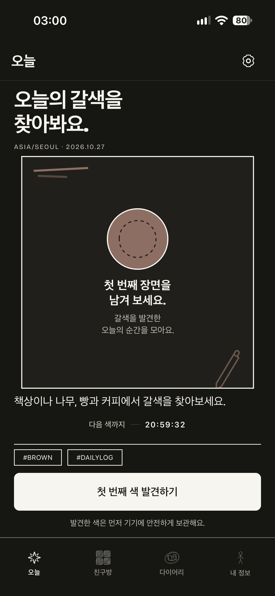
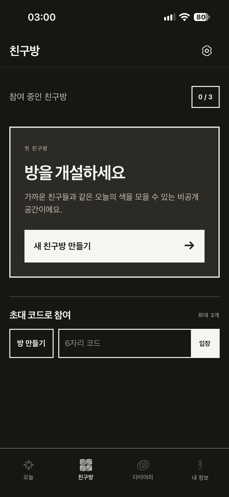
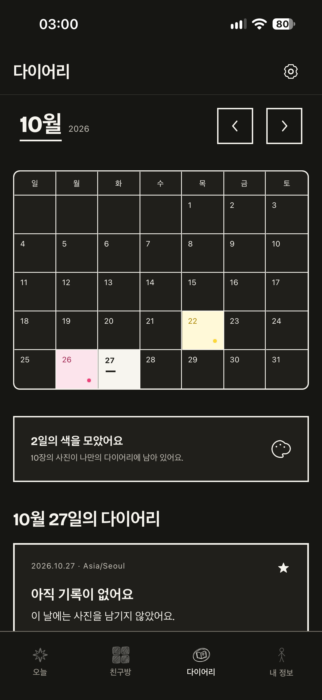

# Color Log

### 하루의 시작, 하나의 색.

매일 만나는 한 가지 색으로 
무심코 지나쳤던 일상을 발견해 보세요.

**색을 찾고 · 순간을 담고 · 하루를 기억해요**

[화면 둘러보기](#화면-둘러보기) · [Color Log와 보내는 하루](#color-log와-보내는-하루)

---

## 평범한 하루에도, 남기고 싶은 색이 있어요

출근길의 빨간 간판, 책상 위 초록 컵, 산책하다 마주친 분홍 꽃.

Color Log는 **오늘의 색을 찾아 사진으로 남기는 다이어리**예요. 무엇을 찍을지, 무슨 말을 써야 할지 고민될 때 오늘의 색이 작은 힌트가 되어 줘요.

멋진 풍경도, 긴 글도 필요 없어요. 눈에 들어온 장면 한 장이면 충분해요.

## 화면 둘러보기

오늘의 색을 여는 순간부터, 달력에 나의 하루가 쌓이기까지.

<table>
  <tr>
    <th align="center">01 · 시작</th>
    <th align="center">02 · 색 열기</th>
    <th align="center">03 · 오늘의 색</th>
  </tr>
  <tr>
    <td width="33%" align="center" valign="top"></td>
    <td width="33%" align="center" valign="top"></td>
    <td width="33%" align="center" valign="top"></td>
  </tr>
  <tr>
    <td align="center">나만의 색 기록을 시작해요.</td>
    <td align="center">오늘은 어떤 색을 만날까요?</td>
    <td align="center">일상 속 갈색을 찾아보세요.</td>
  </tr>
  <tr>
    <th align="center">04 · 오늘 기록</th>
    <th align="center">05 · 친구방</th>
    <th align="center">06 · 다이어리</th>
  </tr>
  <tr>
    <td align="center" valign="top"></td>
    <td align="center" valign="top"></td>
    <td align="center" valign="top"></td>
  </tr>
  <tr>
    <td align="center">한 장으로 시작하는 오늘.</td>
    <td align="center">같은 색, 서로 다른 하루.</td>
    <td align="center">하루하루 쌓이는 나의 기록.</td>
  </tr>
</table>

## Color Log와 보내는 하루

### 매일, 새로운 발견의 시작

오늘은 어떤 색을 만나게 될까요?

오늘의 색을 열고 주변을 둘러보세요. 노란 우산, 파란 하늘, 갈색 커피처럼 익숙한 것들이 조금 다르게 보일 거예요. 색과 함께 전해지는 짧은 힌트를 따라 나만의 장면을 찾아보세요.

### 한 장이면 충분하고, 아홉 장이면 풍성해요

발견한 순간을 정사각형 사진으로 담아 보세요. 직접 촬영하거나 갤러리에서 사진을 가져올 수 있어요.

하루에 **최대 9장**까지 차곡차곡 모으고, 마음에 드는 순서로 배치해요. 사진에 짧은 메모를 더하면 그 순간의 기분까지 남길 수 있어요. 모든 칸을 채우지 않아도 괜찮아요. 한 장도 소중한 하루의 기록이에요.

### 오늘의 색을 더 선명하게

사진 속 오늘의 색에 시선을 모아 보세요.

**‘오늘의 색만 보기’**를 켜면 오늘의 색과 가까운 부분은 컬러로, 나머지는 차분한 흑백으로 보여요. 복잡한 풍경 속에서도 내가 발견한 색을 돋보이게 할 수 있어요. 오늘 사진함에 담아 둔 사진에서도 이 보기를 켜 볼 수 있어요.

### 달력에 쌓이는 나만의 팔레트

사진을 남긴 날들이 달력 위에 색으로 쌓여요.

날짜를 눌러 그날의 사진과 메모를 다시 꺼내 보세요. 하루의 사진을 **한 장의 콜라주로 저장하거나 공유**할 수도 있어요. 따로 보면 작은 순간들이 모여, 나만의 이야기가 돼요.

### 같은 색, 서로 다른 하루

혼자 기록하는 즐거움을 가까운 사람과 나누고 싶다면 **비공개 친구방**을 열어 보세요.

초대 코드로 친구를 초대하고, 최대 6명이 같은 오늘의 색을 찾아요. 누군가는 꽃에서, 누군가는 저녁 식탁에서 같은 색을 발견하겠죠. 서로 다른 장면으로 친구의 하루를 만나 보세요.

친구방은 최대 3개까지 함께할 수 있어요. 방을 나가더라도 내가 남긴 사진과 개인 다이어리는 그대로 간직해요.

---

## 나의 속도와 취향에 맞게

- **혼자서도 즐겁게** — 친구를 초대하지 않아도 오늘의 색과 개인 다이어리를 이용할 수 있어요.
- **눈에 편안한 화면으로** — 라이트 모드와 다크 모드 중 편한 분위기를 골라요.
- **잊지 않도록 가볍게** — 기록 리마인더와 친구방 사진 알림을 원하는 대로 설정해요.
- **익숙한 언어로** — 한국어와 영어를 지원해요.

## 이런 분께 추천해요

- 일기를 쓰고 싶지만 빈 페이지 앞에서 망설여지는 분
- 휴대폰 속 사진을 날짜별 추억으로 모으고 싶은 분
- 매일 걷는 길에서 작은 새로움을 찾고 싶은 분
- 가까운 사람과 부담 없이 일상을 나누고 싶은 분

---

**오늘은 어떤 색을 발견하셨나요?**

오늘의 색을 열고, 주변을 둘러보고, 한 장을 남겨 보세요. 
Color Log에 당신만의 하루가 쌓입니다.

